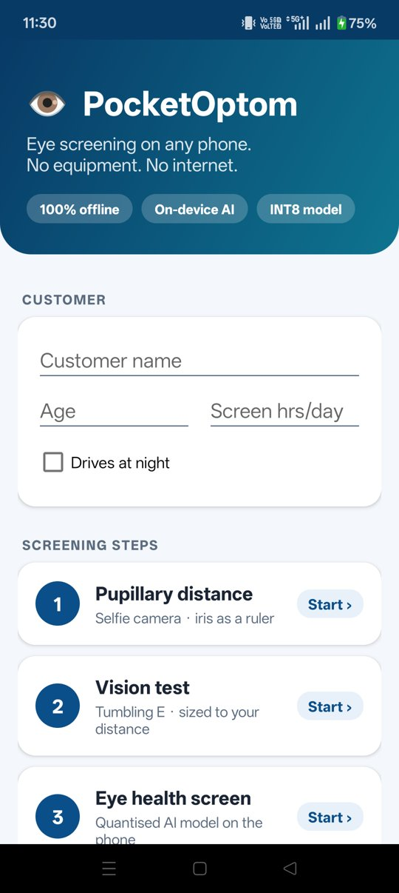
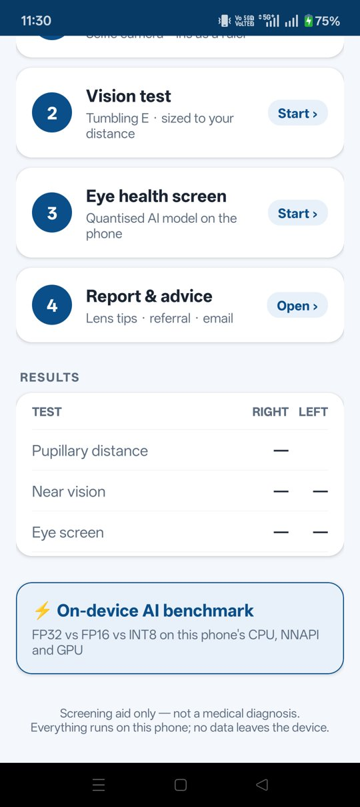
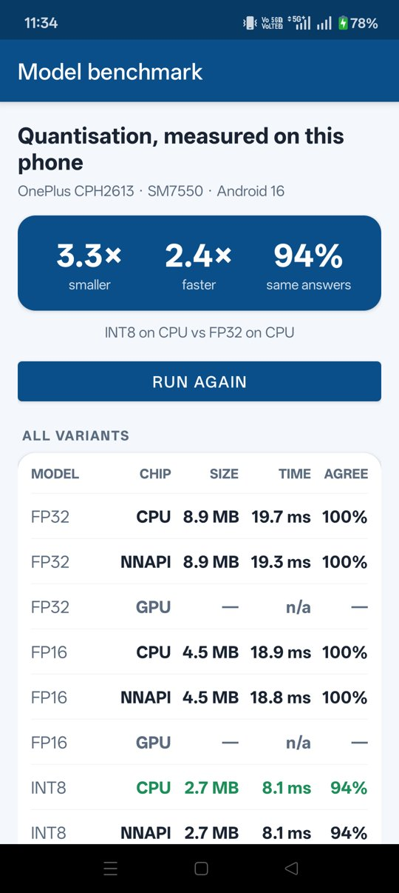
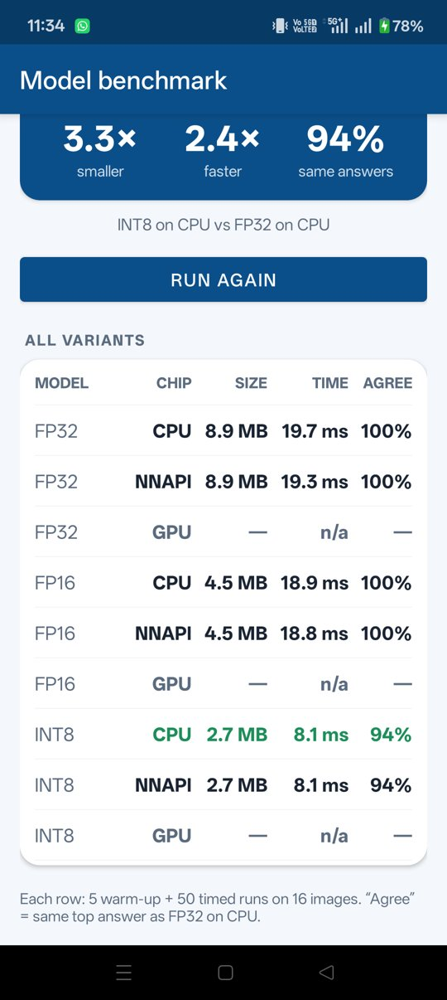

# 👁 PocketOptom

**Eye screening on any Android phone. No equipment. No internet.**

Built for the ZEISS India Hackathon *Beyond Code 2026* — theme: *No-Device Vision Intelligence & Accessible Clinical UX*.

Most small and rural optical stores in India have no eye-testing equipment and patchy internet, so customers
get their pupillary distance and lenses by guesswork. PocketOptom turns a budget Android phone into a guided
screening station. Everything runs on the device — no cloud, no customer data leaving the phone.

<p align="center">
  
  &nbsp;
  
  &nbsp;
  
</p>

## What it does

| Step | How |
|---|---|
| **1. Pupillary distance** | MediaPipe Face Landmarker finds the irises. The human iris is ~11.7 mm wide, so it works as a built-in ruler — no reference card. 30 frames → median, corrected from near PD (looking at the phone) to distance PD. |
| **2. Vision test** | Tumbling-E near-acuity test, one eye at a time. The camera measures face-to-screen distance live and resizes each letter so it always covers the correct visual angle (logMAR standard). |
| **3. Eye health screen** | Crops each eye using the iris landmarks and runs **our own INT8-quantised MobileNetV2** (normal vs cataract) on the phone. |
| **4. Report** | PD, acuity (Snellen + logMAR), screen result, explainable referral rules, lens/coating suggestions. One tap to email it. |
| **Benchmark** | Runs the eye model as FP32 / FP16 / INT8 on CPU / NNAPI / GPU **on the phone itself**: size, median latency, agreement with FP32. |

## Results

### Quantisation, measured on a real phone
OnePlus Nord CPH2613 · Snapdragon 7 Gen 3 (SM7550) · Android 16 — median of 50 runs after 5 warm-up runs.

| Model | Size | CPU | NNAPI | GPU | Same answer as FP32 |
|---|---|---|---|---|---|
| FP32 | 8.9 MB | 19.7 ms | 19.3 ms | not supported | 100% |
| FP16 | 4.5 MB | 18.9 ms | 18.8 ms | not supported | 100% |
| **INT8** | **2.7 MB** | **8.1 ms** | **8.1 ms** | not supported | 94% |

**INT8 vs FP32: 3.3× smaller, 2.4× faster.** (The TFLite GPU delegate is not supported on this phone.)
"Same answer" is measured on 16 inputs, half of them random-noise images, which exaggerate disagreement —
on real eye photos accuracy is unchanged (below).

### Accuracy (121 held-out eye photos)

| Model | Size | Accuracy | Latency on a Mac (M3) |
|---|---|---|---|
| FP32 | 8.88 MB | 95.0% | 4.50 ms |
| FP16 | 4.47 MB | 94.2% | 2.52 ms |
| **INT8** (full-integer, calibrated on 200 images) | **2.71 MB** | **95.0%** | **1.23 ms** |

Full-integer INT8 (weights *and* activations) runs integer kernels end to end, unlike dynamic-range INT8,
which is slower than FP32 on many CPUs.

<p align="center">
  
</p>

## Run it

**Android Studio:** open this folder, connect a phone with USB debugging on, press **Run**.

**Command line** (what this project was built with):
```bash
export JAVA_HOME=<JDK 17>                     # Gradle 8.9 does not run on JDK 22+
echo "sdk.dir=<path to Android SDK>" > local.properties
./gradlew assembleDebug
adb install -r app/build/outputs/apk/debug/app-debug.apk
```
The first build downloads MediaPipe's `face_landmarker.task` (3.7 MB) into `app/src/main/assets/`.
The trained eye models are already in `app/src/main/assets/models/`.

## Retrain the eye model

```bash
cd ml
python3 -m venv .venv && .venv/bin/pip install -r requirements.txt
# dataset: Kaggle "nandanp6/cataract-image-dataset" → processed_images/{train,test}/{normal,cataract}
.venv/bin/python train_eye_model.py --data <path>/processed_images --out ../app/src/main/assets/models
```
The script fine-tunes MobileNetV2 (frozen base, then the top 30 layers), and writes `eye_fp32.tflite`,
`eye_fp16.tflite`, `eye_int8.tflite`, `eye_labels.txt`, `model_config.json` and `benchmark_host.json`.
Normalisation lives inside the model, so the app feeds raw RGB pixels.

Models from [quantisation_tool](https://github.com/kashyap0612/quantisation_tool) (PyTorch → ONNX → TFLite) also
work: drop them in as `eye_fp32/fp16/int8.tflite` and set ImageNet normalisation in `model_config.json`
(`{"mean":[123.675,116.28,103.53],"std":[58.395,57.12,57.375]}`). NCHW inputs are detected automatically.

## Code map — read in this order

| # | File | What you learn |
|---|---|---|
| 1 | `EyeOptics.java` | Pure Java maths: iris ruler, near → far PD, letter size from logMAR |
| 2 | `Session.java` | Static fields shared between screens |
| 3 | `MainActivity.java` + `activity_main.xml` | Activities, layouts, cards, click listeners, Intents, runtime permissions |
| 4 | `vision/FaceTracker.java` | CameraX, background threads, callbacks, MediaPipe |
| 5 | `PdActivity.java` | Implementing an interface (`FaceTracker.Listener`), collecting samples, median |
| 6 | `ui/TumblingEView.java` | Custom View: `onDraw`, `Canvas`, `invalidate()` |
| 7 | `AcuityActivity.java` | A small state machine (the staircase test) |
| 8 | `ml/TfliteClassifier.java` | TFLite Interpreter, delegates, quantised inputs/outputs, `ByteBuffer` |
| 9 | `ml/Benchmark.java` + `BenchmarkActivity.java` | Timing, percentiles, `ExecutorService`, tables in code (`ui/Ui.java`) |
| 10 | `EyeScreenActivity.java`, `Recommender.java`, `ReportActivity.java` | Putting it together, email Intent |

## Limitations and next steps

- Screening aid, not a diagnosis or prescription.
- The eye model is trained on close-up web photos; phone selfie crops look different. **Next:** fine-tune on
  real phone photos (the eye screen already saves its crops for this).
- Iris-based PD assumes an 11.7 mm iris (real range ~±0.5 mm). **Next:** validate against an optometrist's PD.
- The vision test measures **near** vision at ~40 cm; short-sightedness needs a distance test.

## Tech stack

Java · Android SDK (XML layouts, Material Components) · CameraX · MediaPipe Face Landmarker ·
TensorFlow Lite (CPU / NNAPI / GPU delegates) · Python + TensorFlow/Keras (training, post-training quantisation)
